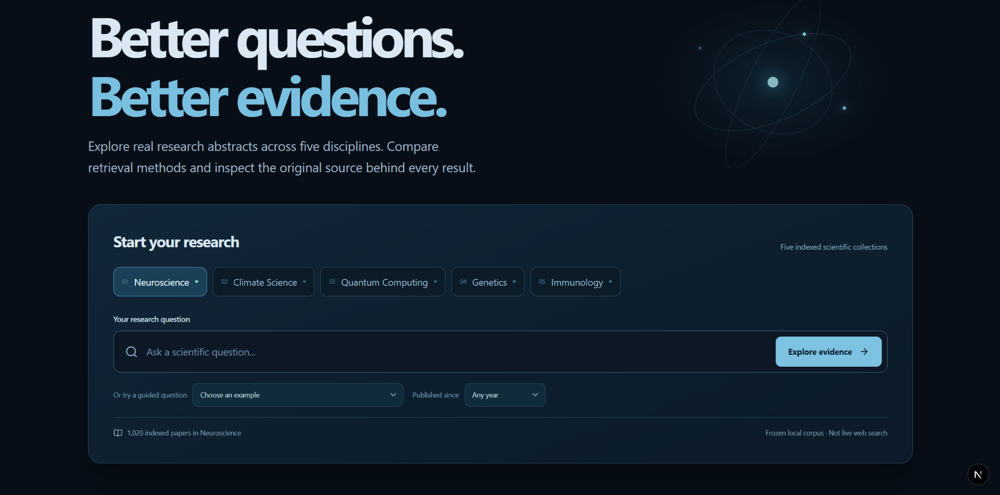

<div align="center">

# EvidenceSearch

**Better questions. Better evidence.**

*A local-first scientific literature search application combining lexical retrieval, transformer embeddings, and cross-encoder reranking.*

</div>



> **Status:** locally tested research prototype; public-hosted inference is **not** enabled. The research corpus, full abstracts, trained/model caches, and provisional annotations are intentionally **not included** in this repository.

## What it does

EvidenceSearch explores five indexed research collections: **neuroscience, climate science, quantum computing, genetics, and immunology**. Visitors can select a research field, start from a guided question or write their own, apply a publication-year filter, inspect ranked papers and original source metadata, and compare retrieval strategies. The local app runs at `http://localhost:3000`.

| Collection | Locally indexed records |
| --- | ---: |
| Neuroscience | 1,020 |
| Climate science | 1,029 |
| Quantum computing | 1,059 |
| Genetics | 1,044 |
| Immunology | 1,042 |

The frozen expanded dataset contains **5,192 globally unique papers** (5,194 domain memberships with two shared Genetics–Immunology records). Counts describe the developer's local dataset snapshot; this repository does not distribute that dataset.

## How retrieval works

```text
Question + field + optional year filter
        |
        +--> BM25 ------------------+
        |                           |--> Reciprocal Rank Fusion --> Cross-encoder --> Papers
        +--> MiniLM dense ranking --+                                  |
        |                                                              +--> source metadata
        +--> TF-IDF baseline (comparison)
```

The service offers BM25, TF-IDF, MiniLM semantic retrieval, Hybrid RRF, and a cross-encoder reranker. Documents are searched from locally indexed research content, **not from live scholarly websites**. Ranking scores indicate retrieval order, not proof that a scientific claim is true.

## Tech stack

- **Backend:** Python, FastAPI, NumPy, SciPy, scikit-learn, sentence-transformers / PyTorch
- **Frontend:** Next.js, React, TypeScript
- **Research process:** dataset checksums, source-provenance records, fixed experiment settings, query-level diagnostics and honest uncertainty reporting
- **Tests:** fixture-based API tests and frontend type/build checks in GitHub Actions

## Evaluation — what is and is not validated

| Experiment | Result | Interpretation |
| --- | --- | --- |
| SciFact internal reserved holdout (647 queries) | cross-encoder + RRF nDCG@10 **0.6953**, Recall@10 **0.8256**, MRR@10 **0.6599** | Frozen internal holdout, **not** a newly scored official SciFact test set |
| Five-domain development (9 matched questions) | cross-encoder + RRF judged-pool nDCG@10 **0.8746** vs BM25 **0.7703** | **Exploratory only:** AI-provisional labels, retrieval-selected judgment pools, incomplete coverage; *not* independent model accuracy |
| Five-domain local smoke test | all 5 domains returned source-matching records | Functional integration check, not an accuracy benchmark or hosted SLA |

See [Evaluation methodology and limitations](docs/EVALUATION.md) for caveats. No claim of superior scientific truth verification is made.

## Run locally

**Prerequisites:** Python 3.12+, Node.js 22+, and the **private local artifacts** generated by the research notebooks. Cloning this repository alone **is not enough** to run the live paper search: see [Local setup and artifact dependencies](docs/LOCAL_SETUP.md).

On Windows, from the repository root, after restoring locally generated artifacts:

```powershell
py -3.12 -m venv .venv
.\.venv\Scripts\python.exe -m pip install -r requirements_m15.txt
cd web
npm ci
npm run build
cd ..
powershell -ExecutionPolicy Bypass -File .\scripts\start_local.ps1
```

Visit `http://localhost:3000`. The backend API is at `http://127.0.0.1:8000/docs`. To verify real paper IDs and abstracts against your local corpus:

```powershell
.\.venv\Scripts\python.exe -u .\scripts\smoke_expanded_research.py
```

The current launcher also checks SciFact artifacts. If those private artifacts have not been reconstructed, the launcher will stop before starting the servers; see the local setup document rather than disabling the checks.

## Repository map

```text
backend/                   FastAPI + retrieval services and fixture-based tests
web/                       Next.js interface and typed API proxy
scripts/                   Local launcher, smoke tests and publication audit
assets/screenshots/        User-captured screenshots suitable for public README/portfolio
.github/workflows/         CI checks (no private corpus needed)
docs/                      Architecture, evaluation, rights, setup and release checklist
```

The **executed research notebooks**, dataset snapshots, caches, and detailed reports stay local for now. Publishing clean notebooks is a separate, human-reviewed step; output cells often contain research abstracts and local paths.

## Publication and data rights

The expanded corpus was acquired from scholarly metadata services, but **none of its abstract-redistribution rights have been independently approved for the public app**. Source links and open-access flags do not themselves establish permission to republish abstracts. Therefore this public-code release excludes those texts, and the live application must remain local until a document-level rights review and production validation are complete.

See [Data and licensing](docs/DATA_AND_RIGHTS.md) and [GitHub release checklist](docs/PUBLISH_CHECKLIST.md).

## Screenshots

- [Main research interface](assets/screenshots/evidencesearch-homepage.png)
- [Homepage visual / branding detail](assets/screenshots/evidencesearch-hero-detail.png)

The screenshots were captured from the developer's running local interface, not generated from fictional article data.

## License status

**A source-code license has not been selected yet.** This repository does not grant a general license for reuse until the owner adds one. Scientific documents, model weights, and underlying papers retain their own terms.
